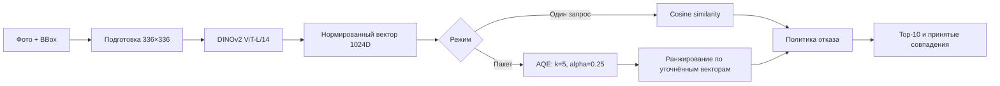

# Vehicle ReID — поиск автомобиля между камерами

**ML-кейс Марии Адюковой · ЛЦТ 2026 · задача «Фалькон Тех».**

Сервис находит один и тот же автомобиль на снимках с разных камер по его
визуальным признакам. На входе — изображение и прямоугольник автомобиля
(BBox), на выходе — Top-10 похожих объектов из галереи либо отказ от
сомнительных совпадений. OCR и признаки государственного номера не используются.

[Презентация · 33 слайда](docs/presentation.pdf) ·
[Демо интерфейса](https://lct-auto-detector.vercel.app) ·
[Результаты](docs/RESULTS.md) · [Запуск ML-приложения](app/README.md)

> Онлайн-демо показывает пользовательский сценарий и использует цветовые
> признаки в браузере. Настоящий DINOv2-инференс и экспорт работают
> в отдельном локальном приложении из `app/`.

## Задача и мой вклад

Это командный хакатонный проект; моя роль — **ML Engineer**. Базовый веб-сервис
создавался совместно с full-stack-разработчиком. Здесь собраны ML-часть,
её интеграция в приложение и материалы решения.

- Исследование данных: разбиение по идентичностям автомобилей, анализ почти
  дублирующихся кадров, cross-camera оценка и разбор ошибок.
- Сравнение энкодеров и схем обучения; дообучение DINOv2-L/14 на данных
  организатора и train-части CityFlow с балансировкой источников.
- Пакетное переранжирование AQE и отдельная политика отказа на основе бустинга.
- Версионированный inference-bundle с проверками SHA256; интеграция
  одиночного/пакетного поиска и экспорта в API и веб-интерфейс.

## Как устроено решение



Галерея создаётся один раз и используется обоими режимами. В одиночном
поиске автомобиль выделяется рамкой; в пакетном изображения сопровождаются
CSV `image_id,x,y,w,h`. Сервис показывает фотографии кандидатов и исходный
cosine score, сохраняет состояние галереи и экспортирует результаты.
Cosine не является вероятностью. При пакетном AQE порядок определяется
отдельным `ranking_score`, а политика отказа использует исходный cosine.

## Результаты

**Внутренняя оценка на данных организатора, FP32, cross-camera протокол.**
Все изображения одного автомобиля относятся к одному split; при оценке
исключаются кандидаты с той же камеры. Это не результат скрытого теста.

| Метод | Dev mAP | Dev Rank-1 | Dev Rank-5 | Calibration mAP |
|---|---:|---:|---:|---:|
| Strong DINOv2-L/14, cosine | 74,05% | 74,26% | 87,99% | 81,37% |
| **Strong DINOv2-L/14 + batch AQE** | **77,63%** | **77,02%** | 87,16% | **84,65%** |

AQE улучшает dev mAP на **3,58 п.п.**, при этом dev Rank-5 снижается на
0,83 п.п. Метод использует весь пакет запросов и галерею: эти метрики
нельзя переносить на одиночный онлайн-запрос. Подробности и размеры выборок
— в [описании оценки](docs/RESULTS.md).

## Что находится в репозитории

| Часть | Где | Назначение |
|---|---|---|
| ML-приложение | [`app/`](app/README.md) | Энкодер, галерея, API, одиночный и пакетный поиск |
| Экспорт | [`app/docs/JUDGE_EXPORT.md`](app/docs/JUDGE_EXPORT.md) | Три конкурсных файла и манифест |
| Исследование | [`app/repro/`](app/repro/README.md) | Подготовка данных, обучение, оценка |
| Демо | [`public/`, `api/`](docs/DEMO.md) | Просмотр сценария без веса модели |
| Презентация | [`docs/presentation.pdf`](docs/presentation.pdf) | Постановка, эксперименты, продукт и масштабирование |

### Быстрый старт ML-приложения

Нужны Python **3.12**, около 1,3 ГБ под вес и отдельное место для галереи.
Вес и изображения не хранятся в Git. Загрузчик получает вес из закреплённого
исходного коммита и проверяет размер и SHA256.

```bash
git clone https://github.com/hissikly/lct_auto_detector.git
cd lct_auto_detector
python3.12 scripts/fetch_model.py
cd app
python3.12 -m venv .venv
.venv/bin/python quick_start.py
```

Открыть **http://127.0.0.1:8000**, загрузить в галерею не менее 10
изображений автомобилей, затем перейти к одиночному или пакетному поиску.
Галерея изначально пуста. На Windows используйте `.venv\Scripts\python.exe`.
Docker и альтернативный путь к скачанному весу — в [руководстве](app/README.md).

## Стек

Python, PyTorch, torchvision, DINOv2, NumPy, pandas, scikit-learn;
FastAPI, SQLAlchemy, SQLite; HTML/CSS/JavaScript; Docker Compose.
FAISS используется в отдельном ANN-эксперименте, а не в основном поиске.

## Проверки и ограничения

Команды тестов и выполненные проверки — в [`docs/VERIFICATION.md`](docs/VERIFICATION.md).
Тесты с фикстурами отделены от исторического smoke с настоящей моделью.

- Скрытый score и производительность на оборудовании жюри неизвестны.
- Exact batch AQE требует квадратичного числа сравнений; поиск по миллиону
  реальных автомобилей не заявляется готовым production-сценарием.
- Полный strong-экспорт 750 gallery + 1110 query и смешанный системный
  file-picker требуют отдельной проверки. Ранее завершён малый smoke 10+2.
- Датасеты и исходные изображения организатора не распространяются.

## Происхождение

Это личная портфолио-публикация командного решения. История стороннего
репозитория не импортирована; происхождение кода и лицензия DINOv2
сохранены в [`THIRD_PARTY_NOTICES.md`](THIRD_PARTY_NOTICES.md).
Общая open-source лицензия на весь командный проект не назначается.

Краткое описание для резюме: [`docs/CV_CASE.md`](docs/CV_CASE.md).
